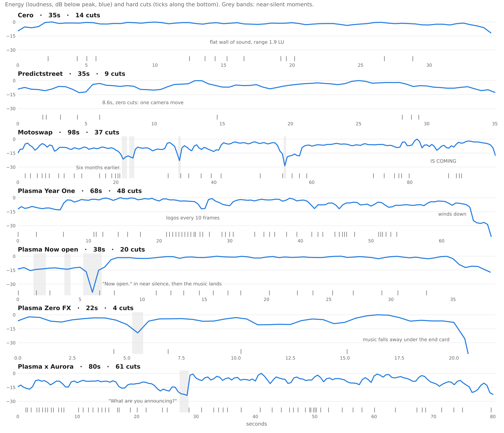

# The Thinking Behind the Films

The playbook says what these films do. This page says why they work, and what the flow looks like when you measure it.

Nine films studied: Cero, Predictstreet, Motoswap, and six from Plasma. Flow numbers come from `tools/flow_report.py`, which anyone can rerun.

---

## 1. Every film starts from one idea, not a list of features

Strip away the footage and each film is one sentence. Each sentence uses a **device**: a repeatable way of turning a product fact into a story.

| Film | Product fact | The idea in one sentence | Device |
|---|---|---|---|
| Cero | You earn rewards when you pay | Paying for a hot dog is a pull on a slot machine | **Make it a game** |
| Predictstreet | You can bet on World Cup matches | One zoom takes a bored fan from his couch into the stadium | **Before and after in one move** |
| Motoswap | Traders get rakeback on swaps | Wall Street holds an emergency meeting because traders finally win | **The world reacts** |
| Plasma Zero FX | No fees abroad | Four taps in four countries, then "0% FX fees." | **Proof before claim** |
| Plasma × Deel | Get paid in stablecoins | "Work happens / everywhere." One sentence, many places | **One sentence, many shots** |
| Plasma Now open | Public launch | Black screen. Near silence. "Now open." Then the music hits | **Subtract** |
| Plasma Year One | Growth milestones | The year told only in numbers and logos | **Receipts** |
| Plasma $100M | Volume milestone | A line going up is the whole drama | **Receipts** |
| Plasma Android | Cashback offer | One unbroken take of the app paying you $10 | **The product is the story** |

Notice what is missing: no film says "fast, secure and easy." Each picks one fact and commits to it.

### The eight devices

1. **Make it a game.** Turn a dull action into play: packs, jackpots, wheels, scores. Cero's opening toss of a lime ball says "chance" before a word appears. Fits rewards, points, loyalty. Fails when the product has no real reward to show.
2. **Before and after in one move.** One transition carries the whole promise. Predictstreet's radial zoom moves the fan from couch to stadium in about a second. Fits anything that changes your role (spectator to player, renter to owner). Fails if the "after" is abstract.
3. **The world reacts.** Show the future as if it already happened: news anchors, boardrooms, podcasts, families arguing about it. Motoswap borrows the grammar of a prestige drama trailer. Fits challengers and category disruptors. Fails without a sense of humour, and turns risky the moment a character looks like a real person.
4. **Proof before claim.** Show the benefit until it's obvious, then say it once. Plasma's FX film shows four countries before the words "0% FX fees." Fits fees, speed, coverage. Fails when the proof isn't visible on camera.
5. **One sentence, many shots.** A single line of copy is the spine, and footage cuts underneath it. "Spend in stablecoins." holds over five places in 3.3 seconds. Fits "anywhere / anytime" benefits. Fails when the sentence is long.
6. **Subtract.** Remove sound, color or motion right before the reveal so the reveal hits harder. Plasma's "Now open." sits on black in near silence. Fits launches and announcements. Fails if overused: once per film.
7. **Receipts.** Numbers are the plot. Each stat is a beat, and growth is the climax. Fits milestones, anniversaries, fundraising. Fails with small or vague numbers.
8. **The product is the story.** One continuous move through the real UI, with numbers ticking. Fits a feature launch with a clear loop (spend, progress, reward). Fails if the UI is cluttered or the loop takes too long to pay off.

---

## 2. Flow: how energy moves through a film



Blue is loudness over time. Ticks along the bottom are hard cuts. Grey bands are moments of near-silence.

### What the measurements show

| Film | Cuts per second, by third | Energy, dB by third | Cuts lock to beat? | Median shot |
|---|---|---|---|---|
| Cero | 0.34 / **0.69** / 0.17 | -2.0 / -1.6 / -2.8 (flat) | No (p=0.85) | 3.0 beats |
| Predictstreet | **0.43** / 0.09 / 0.26 | -7.9 / -4.6 / -5.4 | No (p=0.61) | 3.5 beats |
| Motoswap | **0.52** / 0.31 / 0.31 | -10.3 / -8.5 / -6.1 (rising) | No (p=0.25) | 4.0 beats |
| Plasma Year One | 0.58 / **1.06** / 0.49 | -4.6 / -4.5 / -11.6 (falling) | **Yes (p<0.001)** | 1.5 beats |
| Plasma Now open | 0.55 / **0.70** / 0.31 | -9.5 / -1.0 / -3.9 (drop) | **Yes (p<0.001)** | 2.2 beats |
| Plasma Zero FX | **0.27** / 0.14 / 0.14 | -6.2 / -6.8 / -16.6 | too few cuts | 5.1 beats |
| Plasma × Aurora | **1.04** / 0.78 / 0.45 | -11.5 / -6.9 / -8.8 | No (p=0.55) | 2.0 beats |

### Five flow rules, with the evidence

1. **The last third slows down. 7 of 7 films.** The final third always cuts slower than the busiest third. Cero goes from 0.69 to 0.17 cuts per second. Year One from 1.06 to 0.49. The viewer is let down gently into the logo, never dropped.

2. **Pick one energy shape and commit.** Four shapes appear:
   - **Plateau** (Cero): loud and flat all the way, range 1.9 LU. Works for a 35-second game spot where every second is a hit.
   - **Drop** (Plasma Now open): quiet setup, then the music lands. First third -9.5 dB, middle -1.0 dB.
   - **Crescendo** (Motoswap): each third louder than the last, from -10.3 to -6.1 dB. Built like a trailer.
   - **Fade** (Year One, Zero FX): energy pulls back 7 to 10 dB in the last third, under the end card.

3. **Silence is punctuation.** 3 of 7 films go near-silent right before their most important line: Motoswap before "Six months earlier.", Plasma before "Now open.", Aurora before "What are you announcing?". Two more let the music fall away under the end card. Silence only works once, so spend it on the line that matters most.

4. **Two ways to cut, one per school.**
   - **Quiet school cuts on the grid.** Plasma's "Now open" and "Year One" lock to the music (p<0.001). The cuts land at 0.77 of the beat, about a quarter beat early, roughly 3 frames at 103 BPM. The new shot registers exactly on the beat. 78% of "Now open" shots last a whole number of beats.
   - **Loud school cuts on action.** Cero, Predictstreet and Motoswap show no beat lock. They cut when something happens in the picture: the ball leaves the hand, the pack bursts, a line of dialogue ends.

   This corrects an earlier rule in the playbook. "Every cut on the beat" was folklore. Only the quiet films do it.

5. **Shots last 2 to 4 beats.** Median shot length in beats ranges from 1.5 (Year One's logo storm) to 4.0 (Motoswap's dialogue). Think in beats, not seconds: pick the track first, then the shot lengths fall out of it.

---

## 3. How we get better

Our first attempts copied what these films look like. Getting better means copying how they were thought up.

1. **Write the idea before any shot.** One sentence, one device, one product fact. If a competitor's logo could sit on the end card and the film would still make sense, the idea isn't ours yet.
2. **Make three concepts from three different devices, then kill two.** The first idea is usually the obvious one.
3. **Draw the energy curve before the storyboard.** Choose plateau, drop, crescendo or fade. Mark where the one silence goes. Mark where the last third slows.
4. **Choose the music first.** Set the tempo, then plan shots in beats.
5. **Measure the draft against the references.**

   ```bash
   .venv/bin/python tools/flow_report.py renders/draft.mp4 --chart renders/draft-flow.png
   ```

   It flags loudness off target, a last third that doesn't slow, shots too long for a short spot, and whether cuts lock to the beat.
6. **Read the film from its contact sheet alone.** One frame per second, no sound. If the story can't be followed from that sheet, it isn't visual enough yet.

The `/creative-director` skill in this repo runs this whole loop.
